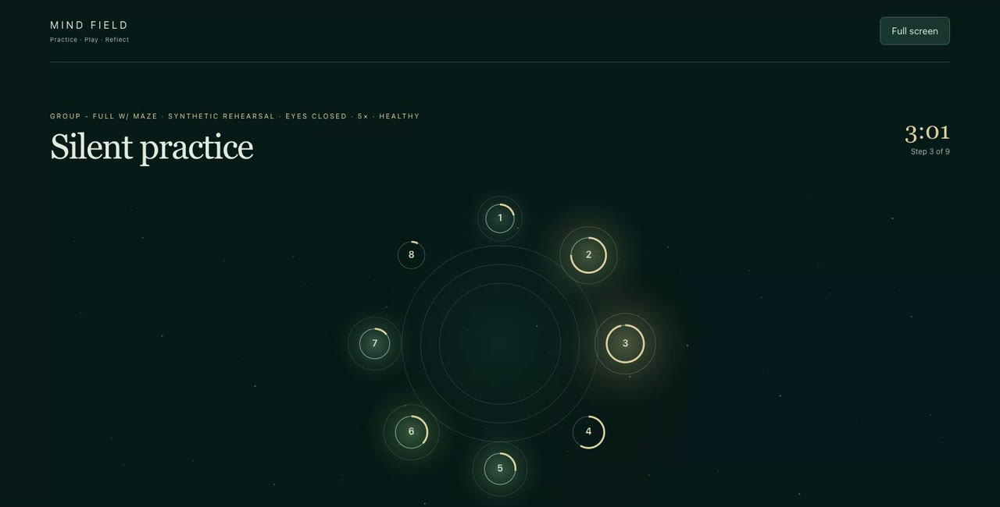
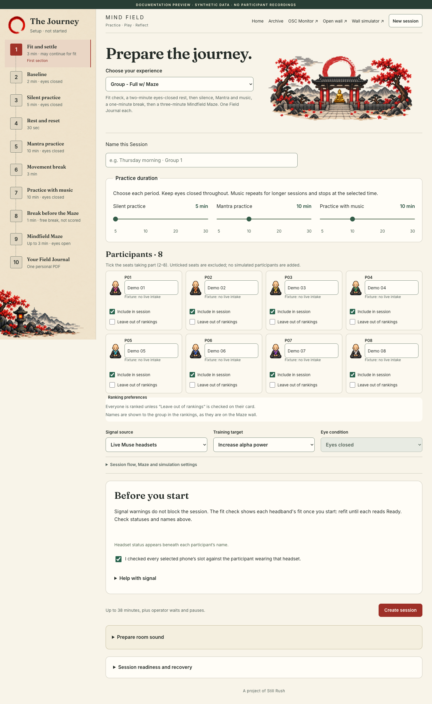
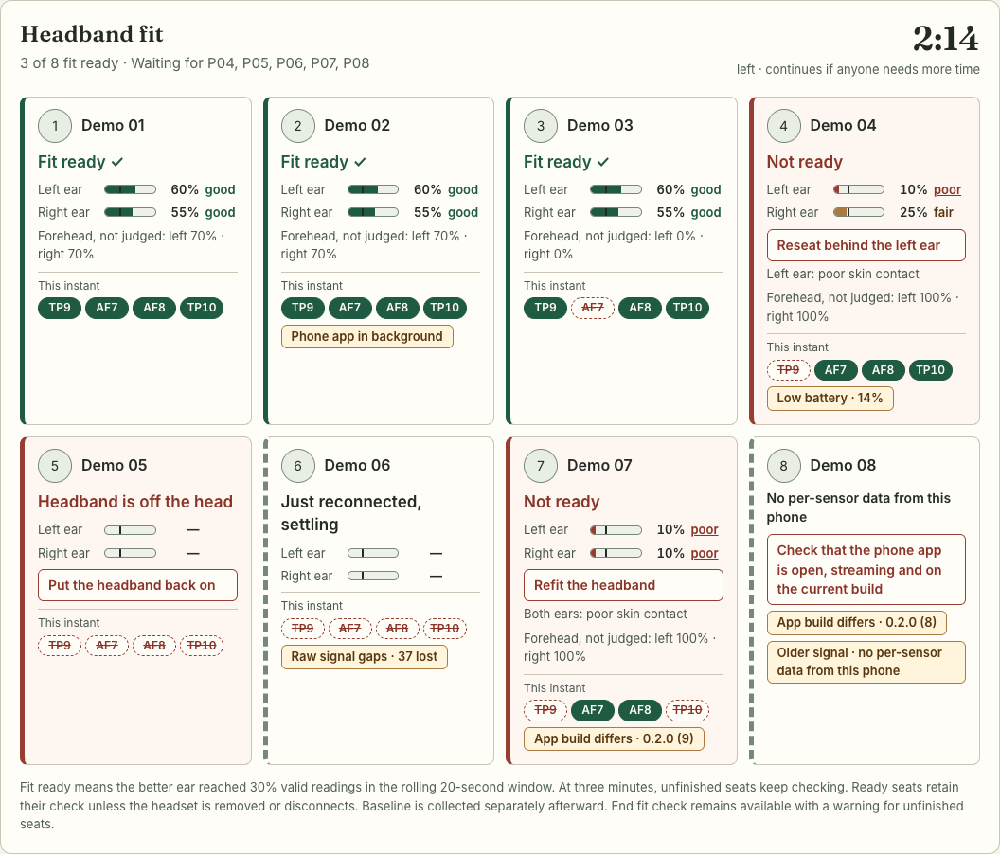

# Mind Field Muse Toolkit

[**Read the Mind Field case study →**](https://corbett.vc/mindfield/)

[](https://corbett.vc/mindfield/)

Four small JavaScript modules for developers building experimental EEG interfaces:
sensor validity, rolling headset-fit checks, packet-loss accounting and an adaptive
game signal. Extracted from Mind Field, a local shared meditation experience.

**Private review edition — 0.1.0.** No open-source license has been selected.
This is not the full Mind Field app, a Muse driver, or a medical device. The
thresholds are provisional engineering choices, not validated clinical criteria.
Muse is a trademark of Interaxon; this project is not affiliated with or endorsed
by Interaxon.

## The experience behind the toolkit

| Silent practice | Mindfield Maze |
| --- | --- |
| [](https://corbett.vc/mindfield/) | [](https://corbett.vc/mindfield/) |

These synthetic rehearsal previews show the original experience. Visit the
[case study](https://corbett.vc/mindfield/) for the story and videos. Graphics are
credited in [asset sources](docs/assets/README.md); this repository contains the
reusable signal modules, not the full application.

## Training screen walkthrough

[**See every Training step, from setup through the Maze →**](docs/training-walkthrough.md)

The gallery includes 11 screenshots of the actual `/training` interface, using
synthetic session views and invented names. It shows setup, fit, Baseline, all
three practices, the intervening breaks and the Maze.

[](docs/training-walkthrough.md)

### Headband fit and sensor connections

[](docs/training-walkthrough.md#fit-test-good-and-poor-sensor-connections)

TP9/TP10 are the ear sensors; AF7/AF8 are forehead sensors. Green pills show
usable readings at this instant; red dashed pills show unusable readings.
The ear meters summarize the rolling fit window. These are **synthetic UI
examples**, not participant data or evidence of hardware validation.

## Run it

Requires Node.js 22 or newer. There are no third-party dependencies and no build step.

```sh
git clone https://github.com/corbett3000/mindfield-muse-toolkit.git
cd mindfield-muse-toolkit
npm test
npm run demo
```

The demo generates an artificial 30-second stream in memory and prints fit and game
state. It needs no headset, credentials, network connection, clock or local files.
GitHub access is required only to clone this private repository.

```js
import { createSensorValidity, createFitWindow } from './src/index.mjs';

const validity = createSensorValidity(); // one instance per headset
const fit = createFitWindow();
validity.ingest('/mindfield/v2/is_good', [0, 10, 0, 1, 1, 1, 1], 1000);
validity.ingest('/mindfield/v2/band/alpha', [0, 10, 0, -1, -1.1, -1.2, -0.9], 1000);
const sensors = validity.snapshot(1050); // local receipt time, milliseconds
console.log(fit.observe(sensors, 1.05).state); // settling; fit uses seconds
```

Continue ingesting fresh data, sample snapshots at a regular cadence (normally twice
a second), and call `fit.observe()` with the same local clock converted to seconds.
See [API](docs/api.md) for the required units, return values and important limits.

## Modules

| Module | Purpose |
| --- | --- |
| `sensor-validity` | Labels each sensor with missing, stale, held, poor-contact, non-finite, below-floor, headband-off and reconnect reasons. |
| `fit-window` | Evaluates the better ear over a rolling window and returns an advisory fit state and action code. |
| `seq-tracker` | Counts missing, duplicate and late packets, with wrap and restart handling. |
| `game-signal` | Smooths a usable scalar into an adaptive walk/rest decision with hysteresis and bounded dropout coasting. |

Modules use standard ES modules, accept caller-supplied time and perform no I/O.
The caller validates input, decodes OSC, identifies each headset and owns state.
Do not send untrusted datagrams directly into these APIs without validation.

## Guides

- [Phone message format](docs/message-format.md): derived bands, quality, heartbeat and raw EEG layouts.
- [Field notes](FIELD-NOTES.md): design lessons and evidence limits.
- [Synthetic fixtures](fixtures/README.md): deliberate faults, expected behavior and reproducibility.
- [Extraction record](docs/extraction.json): source revision and SHA-256 for each unchanged module.
- [Review and release checklist](docs/review.md): decisions remaining before a public release.

## Scope and limitations

This edition implements Tier 1 of the toolkit plan. It contains no participant
recordings, source Git history, private reports, SDK, phone application,
network receiver, cloud hosting or lighting. Approved case study graphics and synthetic Training screenshots
are included for documentation. The raw EEG format is documented;
raw recording and spectral analysis are not implemented here. Full-session scoring
fixtures and the Mind Field scoring engine are also outside this edition.

Validity defaults inspect alpha for freshness and held values, not every band's
freshness. Quality flags persist until replaced. Blink/jaw events do not gate this
rule and there is no motion-artifact detector. A fit verdict cannot certify EEG
quality, and the adaptive game output is not a meditation score. Keep missing
measurements missing, and do not interpret coasting as a new valid observation.

Tests establish deterministic software behavior on synthetic inputs. They do not
establish hardware compatibility, clinical effectiveness or multi-person reliability.
Original source comments refer to historical bench work; they are not claims about
the current extent of validation. See [field notes](FIELD-NOTES.md).
