# Training screen walkthrough

Screenshots of Mind Field’s actual `/training` interface, captured November 27,
2026 using an isolated browser and synthetic session views. Names are invented;
there are no participant recordings. The interface is shown in its Live Muse
operator layout so the sensor tools are visible, but **all displayed sensor data
is synthetic**. These images document the full application, not UI included in
this signal-processing toolkit.

The full group journey is:

**Setup → Fit and settle → Baseline → Silent → Rest → Mantra → Movement break →
Music → Break → Maze → Field Journal.**

## Setup and journey outline

Choose the experience, practice durations and included seats. The left sidebar
shows the sequence, eye conditions and planned durations.

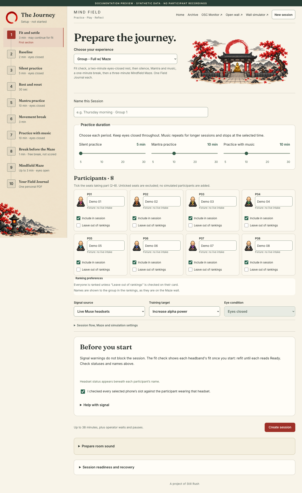

## Fit test: good and poor sensor connections

The expanded board below shows all four sensor indicators: **TP9 and TP10 are the
ear sensors; AF7 and AF8 are forehead sensors**. Solid green pills indicate usable
readings at that instant; red dashed/struck-through pills indicate unusable readings.
The ear meters show valid-reading shares over the rolling window, so a momentary
sensor dropout and an overall fit verdict can differ.

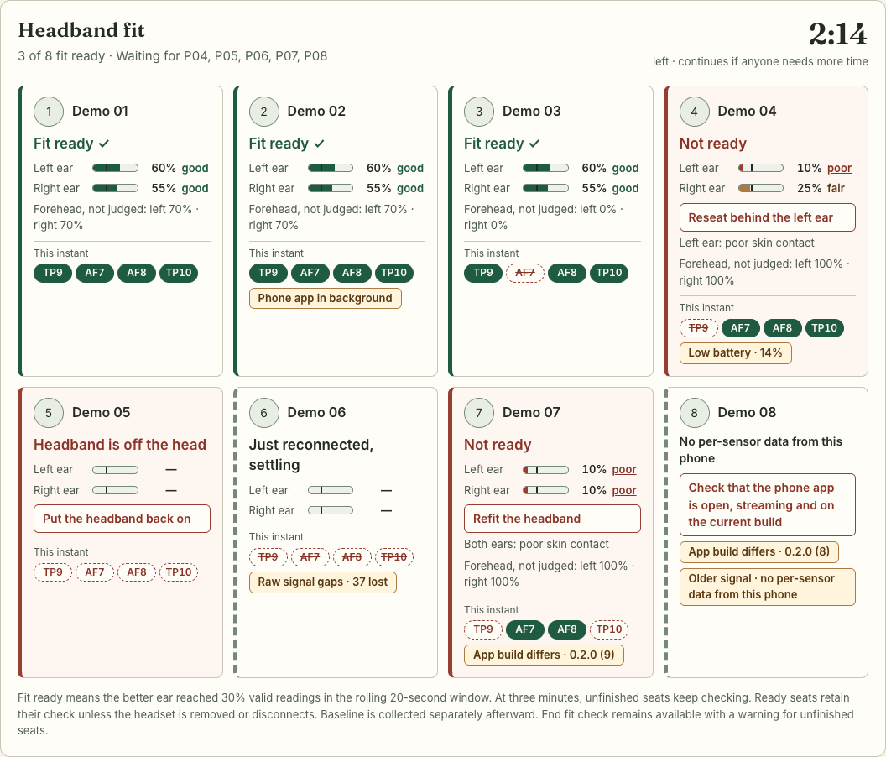

In this synthetic example:

| Demo seat | What to look for |
| --- | --- |
| 01 | Fit ready; all four current sensor indicators are green. |
| 02 | Fit ready, with a separate phone-in-background warning. |
| 03 | Ear sensors ready despite an unusable forehead sensor at this instant. |
| 04 | Not ready: 10%/25% ear-validity shares, reseat advice, a held ear reading and low battery. |
| 05 | Headband off; all current sensor indicators are unusable. |
| 06 | Reconnecting/settling, with a separate raw-packet-gap warning. |
| 07 | Both ears poor; refit advice while forehead indicators remain green. |
| 08 | Older-phone example with no per-sensor report, so no sensor verdict is invented. |

Fit readiness uses the better ear reaching 30% valid observations in the rolling
20-second window. These are provisional application thresholds. Fit and Settle
continues beyond three minutes for unfinished seats; Baseline is a separate step.
The operator can explicitly end the fit check with a warning.

Show the full fit screen, including journey sidebar and operator controls

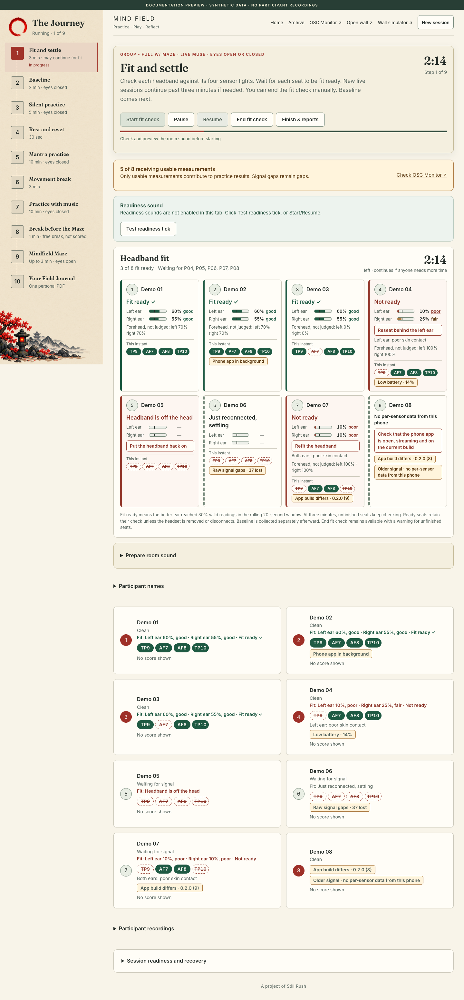

## 2. Baseline

Two minutes of eyes-closed rest. The private readiness cards show usable reference
seconds for each ear. Reaching the minimum reference amount is not a guarantee of
a score or signal quality.

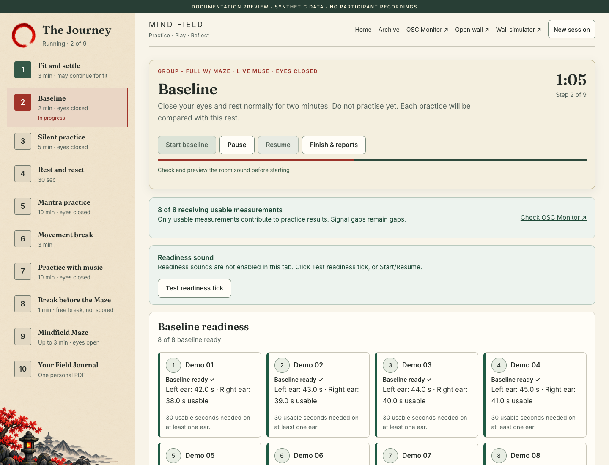

## 3. Silent practice

The operator starts the eyes-closed practice. The sidebar marks the current step
and the main panel shows the cue, timer and controls.

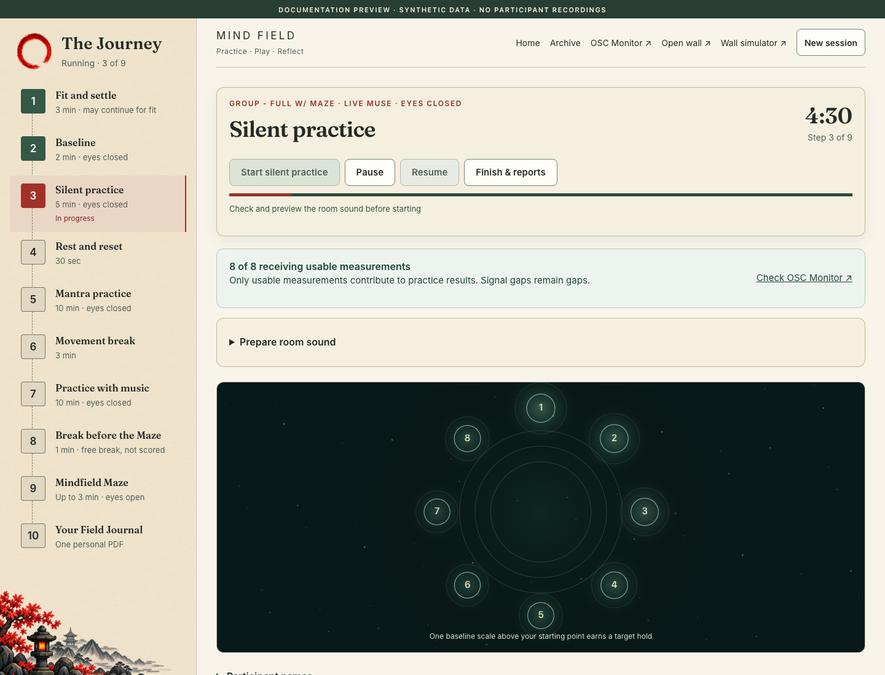

## 4. Rest and reset

A 30-second rest between Silent and Mantra. The operator may skip this break.

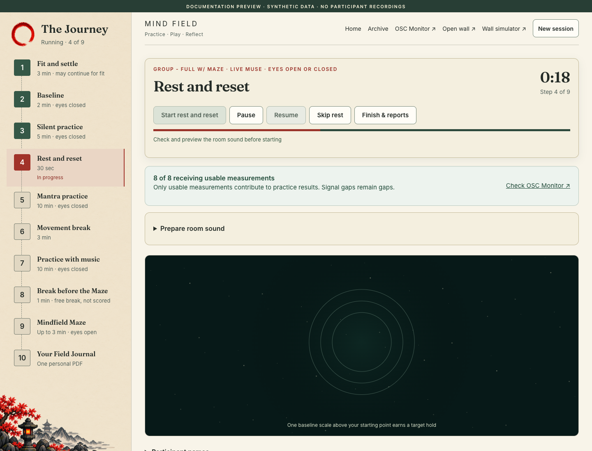

## 5. Mantra practice

An eyes-closed practice with the instruction to repeat a mantra silently.

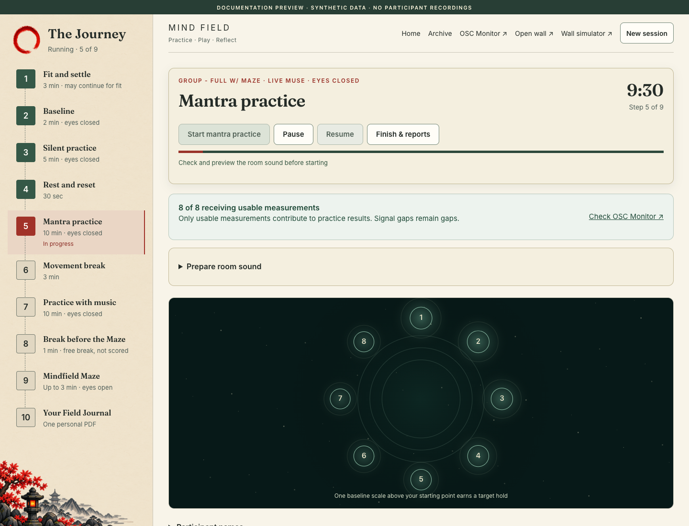

## 6. Movement break

A three-minute opportunity to move and stretch, with a skip control.

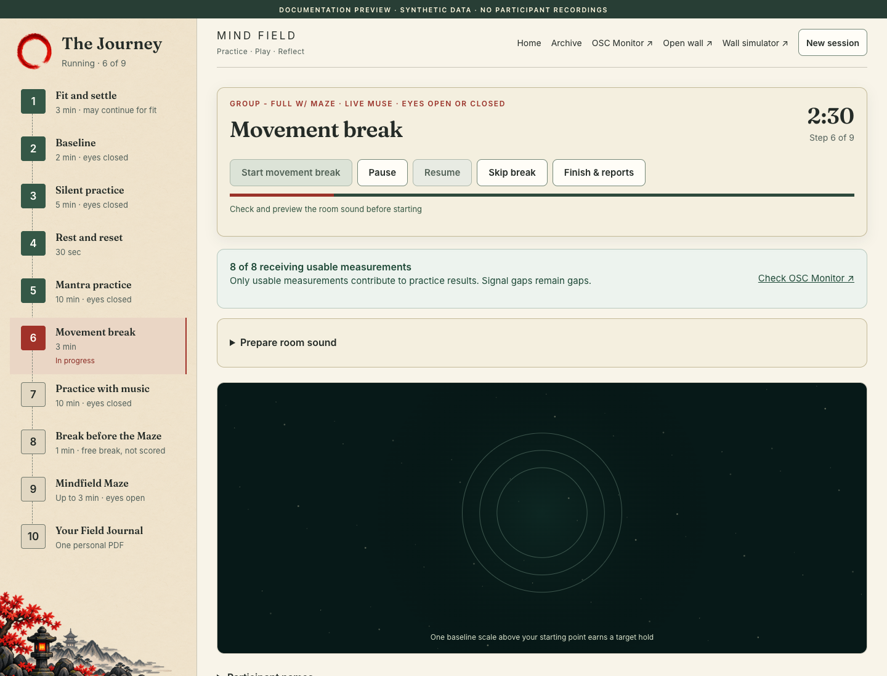

## 7. Practice with music

The operator tab owns music playback. This screenshot shows the controls; the
capture was silent and does not demonstrate room audio or playback timing.

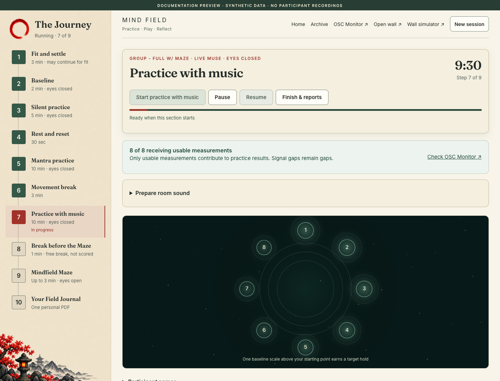

## 8. Break before the Maze

A one-minute break before the eyes-open game, also skippable.

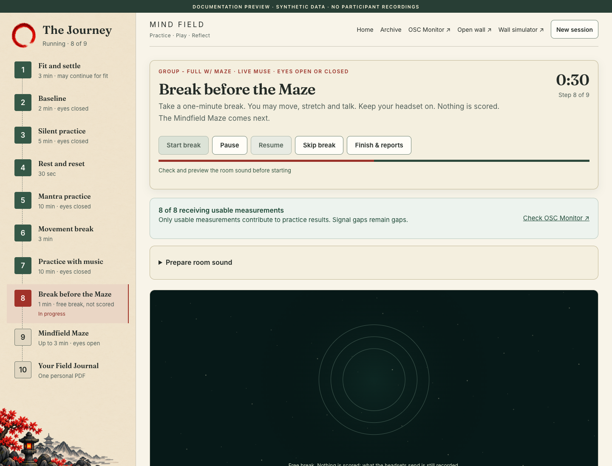

## 9. Mindfield Maze

Each player’s character moves according to that player’s signal. This preview uses
invented progress values to illustrate the operator view. The journey concludes
with participant Field Journals; no report or recording was generated for these
screenshots.

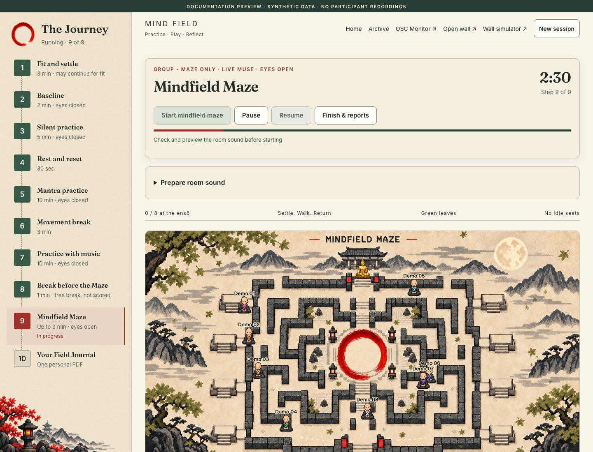

## Capture provenance

The frontend and phase list come from Mind Field revision
`562b27ba7e7f5fe62230459ffeebabb2428aa31b`. Capture used the existing isolated
fixture harness, with no room service, headset, UDP intake or archive access.
A documentation banner was added before capture; the sensor close-up is a crop
of the fit panel. The captures are illustrative UI fixtures, not an end-to-end
session or physical hardware validation. Dimensions and hashes are recorded in
[the screenshot manifest](assets/training/manifest.json).

For the experience story and videos, visit the [Mind Field case study](https://corbett.vc/mindfield/).
